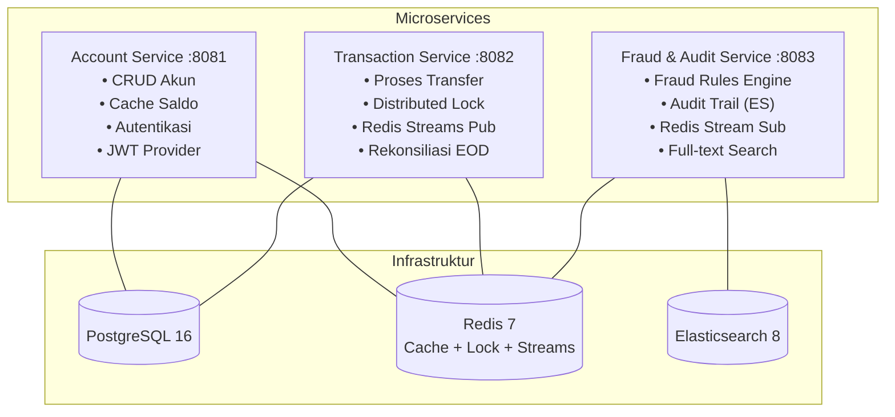
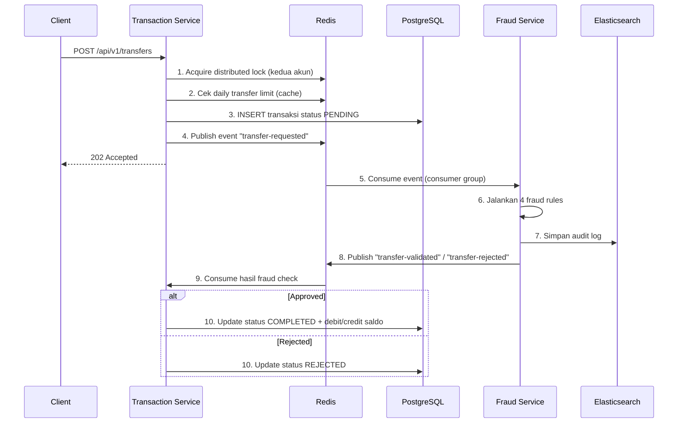

# MiniBank — Distributed Fund Transfer & Fraud Detection

Sistem transfer dana terdistribusi dengan deteksi fraud secara real-time menggunakan arsitektur microservices.

---

## Daftar Isi

1. [Cara Menjalankan Aplikasi](#-cara-menjalankan-aplikasi)
2. [Contoh Test: Good Case](#-contoh-test-good-case-transfer-berhasil)
3. [Contoh Test: Negative Case](#-contoh-test-negative-case-transfer-ditolak)
4. [Penjelasan Teknis](#-penjelasan-teknis)

---

## 🚀 Cara Menjalankan Aplikasi

### Catatan

> [!NOTE]
> File konfigurasi `application.yml` di setiap service **sengaja disertakan** dalam repositori ini untuk memudahkan proses pengetesan lokal. File-file ini tidak mengandung kredensial sensitif yang bersifat rahasia; semua konfigurasi (seperti JWT Secret) menggunakan nilai default atau variabel lingkungan yang ditujukan hanya untuk keperluan pengembangan dan pengujian di lingkungan lokal.

### Prasyarat

| Tool | Versi |
|---|---|
| Java | 25 (Temurin) |
| Maven | 3.9+ |
| Docker + Compose | Terbaru |

Kebutuhan mesin: ±4 GB RAM kosong (Elasticsearch ±1 GB, tiap service Java ±400–600 MB) dan ±3 GB disk untuk image Docker. Port yang dipakai: 8081, 8082, 8083, 5432, 6379, 9200. Opsional: `curl` + `jq` untuk `scripts/export-openapi.sh`.

### Opsi A — Development lokal dengan [mise](https://mise.jdx.dev)

Repo ini punya `mise.toml` yang memasang Java 25 dan Maven, plus task untuk menjalankan semuanya. Infrastruktur jalan di Docker, sedangkan service jalan langsung di mesin (lebih cepat untuk debug dan restart).

```bash
mise install              # pasang Java 25 + Maven
mise run infra            # Postgres, Redis, Elasticsearch (Docker)

mise run account          # terminal 1 — jalankan dulu, ini yang mengisi data awal
mise run transaction      # terminal 2
mise run fraud            # terminal 3
```

Task lain: `mise run test` (build + test semua service), `mise run openapi:export`, `mise run infra:down`. Lihat semua dengan `mise tasks`. Tidak ada env var yang wajib, karena `application.yml` sudah mengarah ke `localhost`.

> Pengguna Nix bisa memakai `nix develop` (lihat `flake.nix`).

### Opsi B — Semua di Docker

#### Langkah 1 — Jalankan Semua (Build + Start)

Cukup satu perintah untuk build semua service dan menjalankan seluruh infrastruktur:

```bash
docker compose up --build
```

> Ini akan otomatis:
> - Build 3 microservice (account, transaction, fraud)
> - Start PostgreSQL, Redis, Elasticsearch
> - Menjalankan **migrasi otomatis** (Hibernate `ddl-auto: update` membuat tabel secara otomatis dari entity Java)
> - Menjalankan **DataSeeder** untuk memasukkan data awal (5 akun + 1 admin)

#### Langkah 2 — Pastikan Semua Service Berjalan

```bash
docker ps
```

Semua container harus berstatus **Up**:

| Container | Port | Fungsi |
|---|---|---|
| `minibank-account-service` | 8081 | Manajemen akun + autentikasi |
| `minibank-transaction-service` | 8082 | Proses transfer + rekonsiliasi |
| `minibank-fraud-service` | 8083 | Deteksi fraud + audit trail |
| `minibank-postgres` | 5432 | Database utama |
| `minibank-redis` | 6379 | Cache, distributed lock, streaming |
| `minibank-elasticsearch` | 9200 | Audit trail + pencarian |

### Langkah 3 — Buka Swagger UI

Buka **http://localhost:8081/swagger-ui.html**. Ketiga service ada di satu Swagger UI: pilih service lewat dropdown **Select a definition** di kanan atas.

1. Jalankan `POST /api/v1/auth/login` (contoh request sudah terisi), salin `accessToken`.
2. Klik **Authorize**, tempel token-nya. Token tetap tersimpan saat pindah service atau reload halaman.
3. Endpoint lain bisa langsung dicoba dengan **Try it out**.

Setiap endpoint mendokumentasikan contoh request/response, kemungkinan error (400/401/403/404/500), dan parameter pagination. Swagger per service juga masih bisa dibuka langsung:

| Service | Swagger UI | Spec OpenAPI |
|---|---|---|
| Account Service | http://localhost:8081/swagger-ui.html | http://localhost:8081/v3/api-docs |
| Transaction Service | http://localhost:8082/swagger-ui.html | http://localhost:8082/v3/api-docs |
| Fraud & Audit Service | http://localhost:8083/swagger-ui.html | http://localhost:8083/v3/api-docs |

Spec hasil ekspor disimpan di [`docs/openapi/`](docs/openapi). Kalau API berubah, jalankan `./scripts/export-openapi.sh` (saat stack menyala) dan commit hasilnya; CI akan gagal kalau spec tidak ikut diperbarui.

> Di production (`SPRING_PROFILES_ACTIVE=prod`) Swagger UI dan `/v3/api-docs` dimatikan.

### Akun Default (Seed Data)

| Email | Password | Role |
|---|---|---|
| `admin@minibank.com` | `admin123` | ADMIN |
| `syarif@minibank.com` | `password123` | USER |
| `budi@minibank.com` | `password123` | USER |
| `citra@minibank.com` | `password123` | USER |
| `dian@minibank.com` | `password123` | USER |
| `eka@minibank.com` | `password123` | USER |

### Menghentikan Aplikasi

```bash
# Stop semua container
docker compose down

# Stop + hapus data (reset database, redis, elasticsearch)
docker compose down -v
```

---

## ✅ Contoh Test: Good Case (Transfer Berhasil)

Berikut langkah-langkah untuk melakukan transfer yang sukses dari awal sampai akhir.

### Step 1 — Login sebagai USER

```bash
curl -X POST http://localhost:8081/api/v1/auth/login \
  -H "Content-Type: application/json" \
  -d '{"email":"syarif@minibank.com","password":"password123"}'
```

**Response yang diharapkan** (HTTP 200):
```json
{
  "accessToken": "eyJhbGciOiJIUzI1NiJ9...",
  "refreshToken": "550e8400-e29b-41d4-a716...",
  "tokenType": "Bearer",
  "expiresIn": 86400,
  "role": "USER",
  "accountId": "a1111111-..."
}
```

> 📌 **Simpan** nilai `accessToken` dan `accountId` dari response ini — akan dipakai di step berikutnya.

### Step 2 — Cek Saldo Akun Pengirim

```bash
curl http://localhost:8081/api/v1/accounts/{accountId}/balance \
  -H "Authorization: Bearer {accessToken}"
```

**Response yang diharapkan** (HTTP 200): saldo awal Rp 100.000.000

### Step 3 — Lakukan Transfer

Transfer Rp 1.000.000 ke akun lain (login dulu sebagai Budi untuk mendapatkan `accountId` tujuan, atau gunakan akun Budi langsung):

```bash
curl -X POST http://localhost:8082/api/v1/transfers \
  -H "Content-Type: application/json" \
  -H "Authorization: Bearer {accessToken}" \
  -H "Idempotency-Key: $(uuidgen)" \
  -d '{
    "fromAccountId": "{accountId_syarif}",
    "toAccountId": "{accountId_budi}",
    "amount": 1000000,
    "description": "Bayar makan siang"
  }'
```

**Response yang diharapkan** (HTTP 202 Accepted):
```json
{
  "transactionId": "uuid-transaksi...",
  "referenceNo": "TXN-20260225-XXXXXX",
  "status": "PENDING",
  "fraudCheckStatus": "PENDING",
  "amount": 1000000
}
```

> 🔁 **Idempotency-Key** (opsional, sangat disarankan): nilai unik per transfer (misalnya UUID, maks. 64 karakter), berlaku per akun pengirim. Kalau request dikirim ulang (misalnya retry setelah timeout) dengan key **dan** body yang sama, server mengembalikan transfer yang pertama dengan header `Idempotent-Replayed: true`, sehingga saldo tidak terpotong dua kali. Kalau key yang sama dipakai untuk body yang berbeda, respons-nya **409 Conflict**.

> Transfer berstatus **PENDING** karena diproses secara **asinkron**. Fraud Service akan mengecek transaksi ini via Redis Stream.

### Step 4 — Cek Status Transfer

Tunggu 1-2 detik, lalu cek status:

```bash
curl http://localhost:8082/api/v1/transfers/{transactionId} \
  -H "Authorization: Bearer {accessToken}"
```

**Response yang diharapkan** (HTTP 200):
```json
{
  "transactionId": "uuid-transaksi...",
  "status": "COMPLETED",
  "fraudCheckStatus": "PASSED",
  "amount": 1000000
}
```

> ✅ Status berubah jadi **COMPLETED** — artinya fraud check lolos dan saldo sudah dipindahkan.

---

## ❌ Contoh Test: Negative Case (Transfer Ditolak)

### Skenario: Transfer Jumlah Besar (Fraud: Large Amount)

Transfer di atas Rp 50.000.000 akan memicu fraud rule **Large Amount** dengan risk score +30.

```bash
curl -X POST http://localhost:8082/api/v1/transfers \
  -H "Content-Type: application/json" \
  -H "Authorization: Bearer {accessToken}" \
  -d '{
    "fromAccountId": "{accountId_syarif}",
    "toAccountId": "{accountId_budi}",
    "amount": 75000000,
    "description": "Transfer besar"
  }'
```

**Response** (HTTP 202): Status PENDING seperti biasa.

Lalu cek status — kemungkinan besar **REJECTED** karena jumlahnya memicu fraud rule. Jika dikombinasikan dengan faktor lain (misalnya transfer di jam 02:00 pagi = +20, atau sudah banyak transfer = +40), total risk score bisa mencapai ≥40 yang menyebabkan **BLOCKED**.

### Skenario: Login dengan Password Salah

```bash
curl -X POST http://localhost:8081/api/v1/auth/login \
  -H "Content-Type: application/json" \
  -d '{"email":"syarif@minibank.com","password":"salah123"}'
```

**Response yang diharapkan** (HTTP 401):
```json
{
  "status": 401,
  "error": "Unauthorized",
  "message": "Invalid email or password",
  "path": "/api/v1/auth/login",
  "timestamp": "2026-02-25T10:15:30"
}
```

### Skenario: Akses Endpoint ADMIN tanpa Izin

Login sebagai USER biasa, lalu coba akses endpoint admin:

```bash
curl http://localhost:8081/api/v1/accounts \
  -H "Authorization: Bearer {accessToken_user}"
```

**Response yang diharapkan** (HTTP 403 Forbidden):
```json
{
  "status": 403,
  "error": "Forbidden",
  "message": "You do not have permission to access this resource",
  "path": "/api/v1/accounts",
  "timestamp": "2026-02-25T10:15:30"
}
```

> Semua error di ketiga service memakai format `ErrorResponse` yang sama (`status`, `error`, `message`, `path`, `timestamp`). Error database dan error tak terduga hanya mengembalikan pesan umum (`A database error occurred` / `Unexpected server error`); detailnya ada di log service.

> Endpoint list (`GET /api/v1/accounts`, `/api/v1/transfers/history`, `/api/v1/audit/**`) memakai pagination: `?page=0&size=20&sort=createdAt,desc` (maks. `size=100`). Response-nya berbentuk `{ "content": [...], "page", "size", "totalElements", "totalPages" }`.

> 🔒 Endpoint `GET /api/v1/accounts` (list semua akun) hanya bisa diakses oleh role **ADMIN**.

### Skenario: Akses Tanpa Token

```bash
curl http://localhost:8081/api/v1/accounts
```

**Response yang diharapkan** (HTTP 401 Unauthorized).

---

## 📖 Penjelasan Teknis

### Arsitektur Sistem



### Requirement ↔ Implementasi

| Requirement | Implementasi | Penjelasan |
|---|---|---|
| **Spring IoC** | `@Service`, `@Repository`, `@Component`, `@Configuration` | Inversion of Control — Spring yang mengelola pembuatan dan injeksi objek, bukan kita manual `new`. Detail di bawah. |
| **Spring Security** | JWT + `@PreAuthorize` + `BCryptPasswordEncoder` | Autentikasi berbasis token JWT, otorisasi berdasarkan role (USER/ADMIN), password di-hash pakai BCrypt. |
| **Java Stream** | `.stream().map().filter().collect()` | Untuk transformasi data — misal konversi list entity jadi list DTO, filter transaksi berdasarkan status, dll. |
| **Advanced Native SQL** | `SUM() OVER`, `LAG`, `LEAD`, CTE | Query SQL kompleks untuk rekonsiliasi akhir hari — menghitung running balance, rata-rata saldo harian. |
| **Containerization** | Docker Compose + 3 Spring Boot microservice | Setiap service di-package jadi Docker image sendiri, dijalankan bersamaan via `docker-compose.yml`. |
| **Stream-Based** | Redis Streams (consumer groups, acknowledgment) | Menggantikan Apache Kafka untuk event streaming antar service (transfer request → fraud check → result). |
| **Redis** | Distributed Lock (Redisson), cache, rate limiting | Lock untuk mencegah transfer race condition, cache saldo, rate limiting untuk fraud detection. |
| **Elasticsearch** | Audit trail + full-text search (fuzzy, multi_match) | Menyimpan log audit di Elasticsearch, bisa dicari dengan query teks bebas. |

---

### Penjelasan Anotasi Spring yang Digunakan

#### Layer Anotasi

| Anotasi | Layer | Fungsi |
|---|---|---|
| `@RestController` | Controller | Menandai class sebagai REST API controller. Otomatis mengubah return value jadi JSON. |
| `@Service` | Service / Business Logic | Menandai class sebagai layer bisnis logic. Spring akan otomatis membuat instance-nya (**bean**) dan meng-inject-nya ke class lain yang membutuhkan. Contoh: `AuthService` berisi logic register, login, refresh token. |
| `@Repository` | Data Access | Menandai interface sebagai layer akses data. Spring Data JPA otomatis membuat implementasinya — kita cukup definisikan method signature, Spring yang generate query SQL-nya. |
| `@Component` | General | Menandai class agar dikelola Spring sebagai bean. Dipakai untuk class yang tidak masuk kategori Service/Repository/Controller. Contoh: `DataSeeder`, `JwtAuthenticationFilter`. |
| `@Configuration` | Config | Menandai class sebagai sumber konfigurasi Spring. Method-method di dalamnya yang ditandai `@Bean` akan menghasilkan objek yang dikelola Spring. Contoh: `SecurityConfig` mendefinisikan `PasswordEncoder` dan `SecurityFilterChain`. |

#### Dependency Injection

```java
@Service
@RequiredArgsConstructor  // Lombok — auto-generate constructor
public class AuthService {
    // Spring otomatis inject object-object ini via constructor
    private final UserCredentialRepository userCredentialRepository;
    private final PasswordEncoder passwordEncoder;
    private final JwtUtil jwtUtil;
}
```

**Cara kerja:** Ketika aplikasi start, Spring membuat semua bean (`@Service`, `@Repository`, dll), lalu **otomatis meng-inject** dependensi yang dibutuhkan ke constructor. Kita tidak perlu `new AuthService(...)` secara manual.

#### Anotasi JPA (Database)

| Anotasi | Fungsi |
|---|---|
| `@Entity` | Menandai class Java sebagai tabel di database. |
| `@Table(name = "accounts")` | Menentukan nama tabel di database. |
| `@Id` | Menandai field sebagai primary key. |
| `@GeneratedValue(strategy = GenerationType.UUID)` | Primary key di-generate otomatis sebagai UUID. |
| `@Column(nullable = false, unique = true)` | Konfigurasi kolom — tidak boleh null, harus unik, dll. |
| `@CreationTimestamp` | Otomatis isi timestamp saat record dibuat. |
| `@UpdateTimestamp` | Otomatis update timestamp setiap kali record diubah. |
| `@Transactional` | Semua operasi database di dalam method ini berjalan sebagai satu transaksi — jika ada error, semua di-rollback. |

#### Anotasi Validasi (Request DTO)

| Anotasi | Fungsi | Contoh |
|---|---|---|
| `@NotBlank` | Field tidak boleh kosong | `@NotBlank(message = "Email is required")` |
| `@Email` | Harus format email valid | `@Email(message = "Invalid email format")` |
| `@DecimalMin` | Nilai minimum | `@DecimalMin("10000.00")` — minimal Rp 10.000 |
| `@Size` | Panjang string | `@Size(min = 6)` — password minimal 6 karakter |
| `@Valid` | Aktifkan validasi di controller | `@Valid @RequestBody LoginRequest request` |

#### Anotasi Security

| Anotasi | Fungsi |
|---|---|
| `@EnableWebSecurity` | Mengaktifkan Spring Security di aplikasi. |
| `@Bean SecurityFilterChain` | Mendefinisikan aturan keamanan — endpoint mana yang butuh login, endpoint mana yang publik. |
| `OncePerRequestFilter` | Base class untuk filter yang dijalankan sekali per request — dipakai oleh `JwtAuthenticationFilter` untuk mengecek token JWT di setiap request. |

---

### Alur Transfer Dana (Detail Teknis)



### Fraud Detection Rules

| Rule | Kondisi | Risk Score | Penjelasan |
|---|---|---|---|
| Large Amount | Transfer > Rp 50.000.000 | +30 | Nominal besar berpotensi mencurigakan. |
| High Frequency | > 10 transfer dalam 1 jam | +40 | Menggunakan Redis counter dengan TTL 1 jam. |
| Suspicious Hours | Jam 00:00 - 05:00 | +20 | Transfer di luar jam wajar. |
| Velocity Check | Tujuan yang sama baru-baru ini | +15 | Mengecek apakah ada transfer ke akun yang sama dalam waktu dekat. |

**Keputusan berdasarkan total risk score:**
- **< 40** → ✅ APPROVED (transfer dilanjutkan)
- **40 - 69** → ❌ BLOCKED (transfer ditolak)
- **≥ 70** → ❌ BLOCKED (transfer ditolak)

---

### Role-Based Access Control

| Endpoint | USER | ADMIN | Keterangan |
|---|---|---|---|
| `POST /api/v1/auth/*` | ✅ | ✅ | Login, register, refresh — publik. Akun hasil register selalu mulai dengan saldo 0 dan limit default. |
| `POST /api/v1/accounts` | ❌ | ✅ | Hanya admin yang bisa buat akun secara manual. |
| `GET /api/v1/accounts` | ❌ | ✅ | List semua akun — admin only. |
| `GET /api/v1/accounts/{id}` | ✅* | ✅ | *USER hanya bisa lihat akun sendiri. |
| `GET /api/v1/accounts/{id}/balance` | ✅* | ✅ | *USER hanya bisa lihat saldo sendiri. |
| `GET /api/v1/accounts/by-number/{no}` | ✅* | ✅ | *Untuk akun orang lain hanya field publik (id, nomor, nama, status). |
| `POST /api/v1/transfers` | ✅* | ❌ | *Hanya dari akun milik sendiri (`fromAccountId` harus sama dengan akun di JWT). |
| `GET /api/v1/transfers/{id}` | ✅* | ✅ | *Hanya pengirim atau penerima. |
| `GET /api/v1/transfers/history` | ✅* | ✅ | *USER hanya bisa lihat riwayat akun sendiri. |
| `GET /api/v1/reconciliation/**` | ❌ | ✅ | Laporan rekonsiliasi harian — admin only. |
| `GET /api/v1/audit/**` | ❌ | ✅ | Audit trail dan pencarian — admin only. |

---

### Struktur Folder Proyek

```
minibank/
├── docker-compose.yml              # Konfigurasi semua container
│
├── account-service/                 # Service 1: Manajemen Akun + Auth
│   └── src/main/java/com/minibank/account/
│       ├── config/                  # Konfigurasi (DataSeeder, OpenAPI, Redis, Security)
│       ├── controller/              # REST API endpoint
│       ├── dto/                     # Data Transfer Object (request/response)
│       ├── entity/                  # JPA Entity (mapping ke tabel database)
│       ├── repository/              # Interface akses database
│       ├── security/                # JWT filter, Security config
│       └── service/                 # Business logic
│
├── transaction-service/             # Service 2: Transfer + Rekonsiliasi
│   └── src/main/java/com/minibank/transaction/
│       ├── config/                  # Redis, Security, OpenAPI
│       ├── controller/              # Transfer + Reconciliation endpoint
│       ├── dto/                     # Transfer request/response DTO
│       ├── entity/                  # Transaction entity
│       ├── listener/                # Redis Stream listener (consume fraud result)
│       ├── repository/              # Database + native SQL queries
│       ├── security/                # JWT validation
│       └── service/                 # Transfer logic + distributed lock
│
└── fraud-service/                   # Service 3: Fraud Detection + Audit
    └── src/main/java/com/minibank/fraud/
        ├── config/                  # Redis Stream, Elasticsearch, Security
        ├── controller/              # Audit search endpoint
        ├── document/                # Elasticsearch document (AuditLog)
        ├── listener/                # Redis Stream listener (consume transfer events)
        ├── repository/              # Elasticsearch repository
        ├── security/                # JWT validation
        └── service/                 # Fraud rules engine
```

---

### Rekonsiliasi Akhir Hari (EOD)

```bash
# Contoh: laporan rekonsiliasi tanggal 25 Feb 2026
curl http://localhost:8082/api/v1/reconciliation/daily?date=2026-02-25 \
  -H "Authorization: Bearer {accessToken_admin}"
```

Menggunakan **Advanced Native SQL**:

- **`SUM() OVER (PARTITION BY account_id ORDER BY created_at)`** — menghitung running balance per akun
- **`LAG()` / `LEAD()`** — melihat transaksi sebelumnya / berikutnya
- **`CTE (WITH clause)`** — menghitung rata-rata saldo harian per akun
